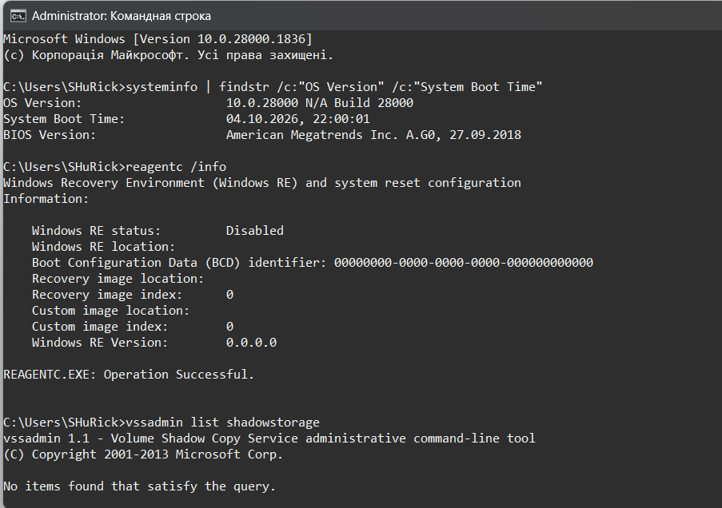
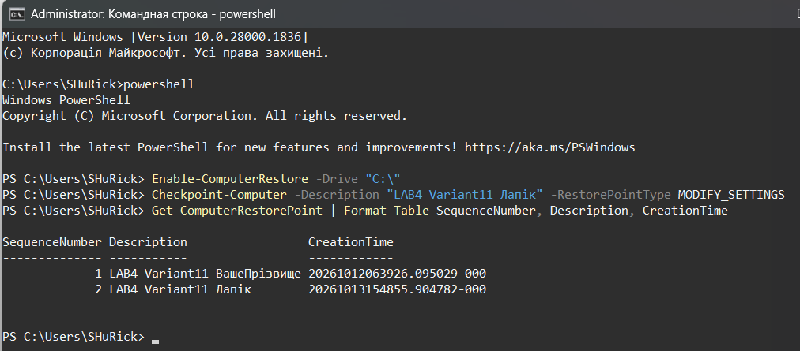
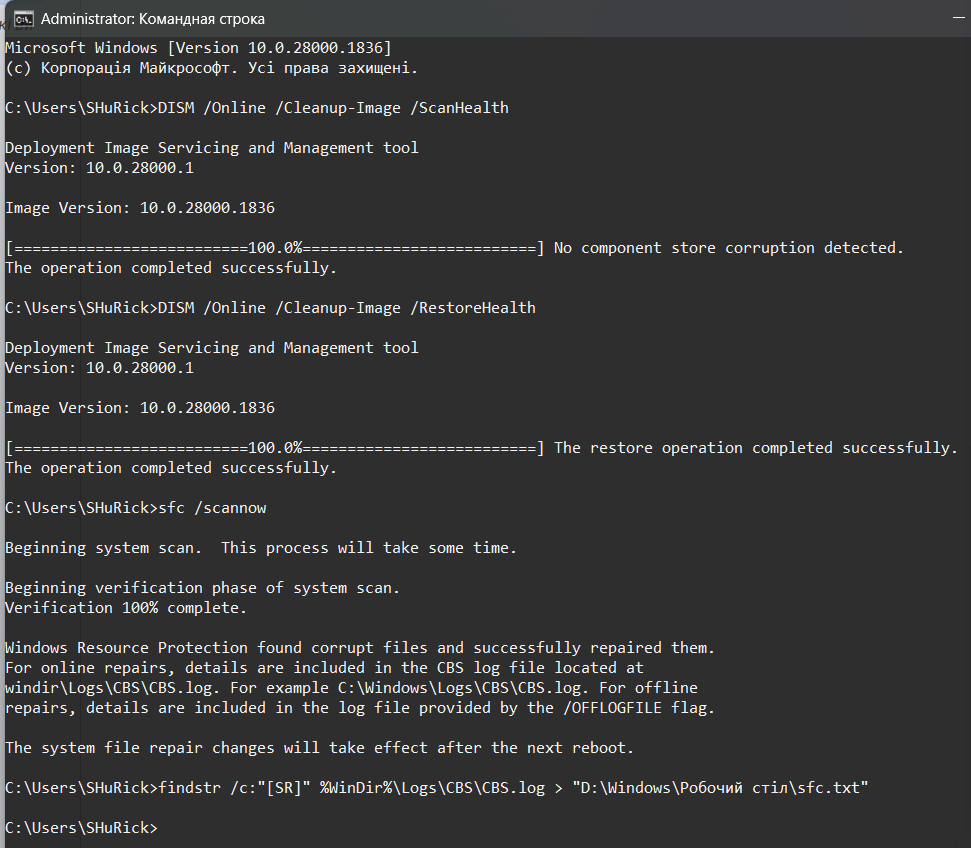
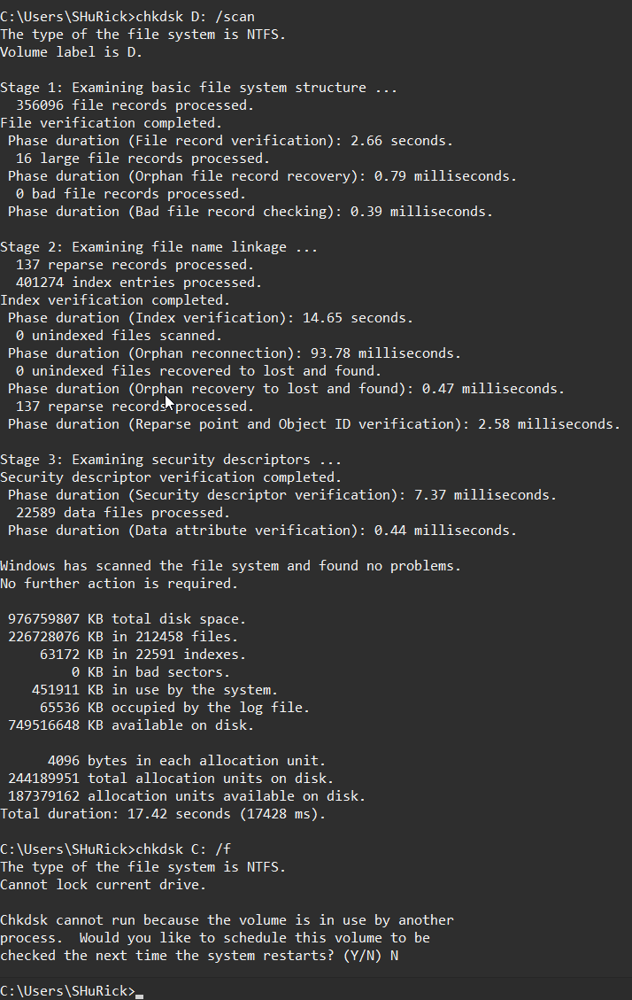
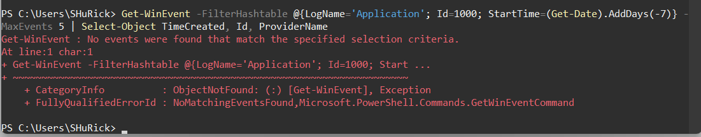
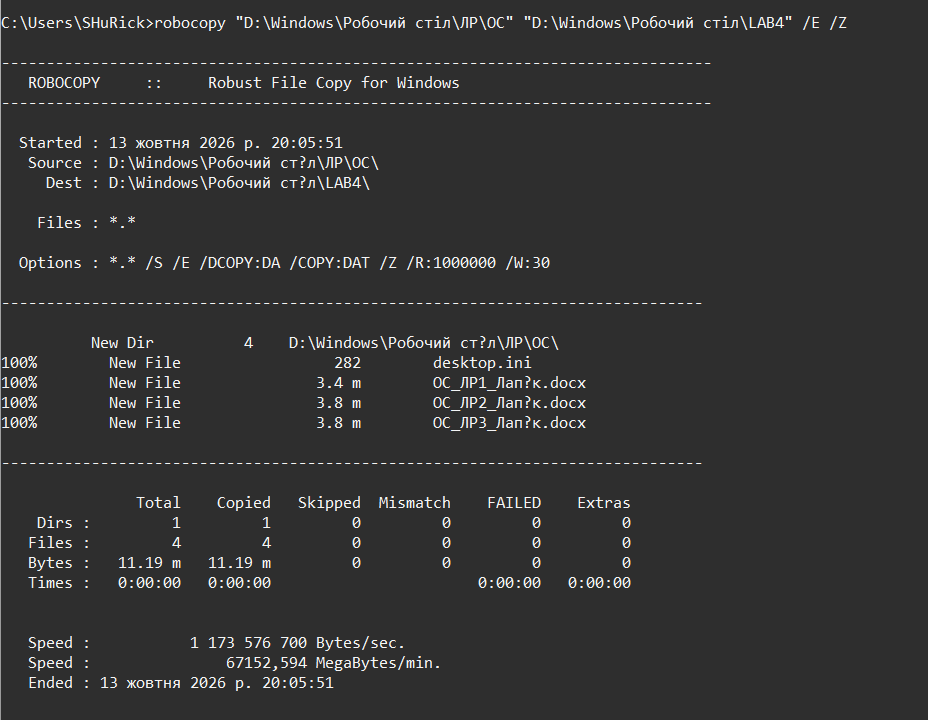
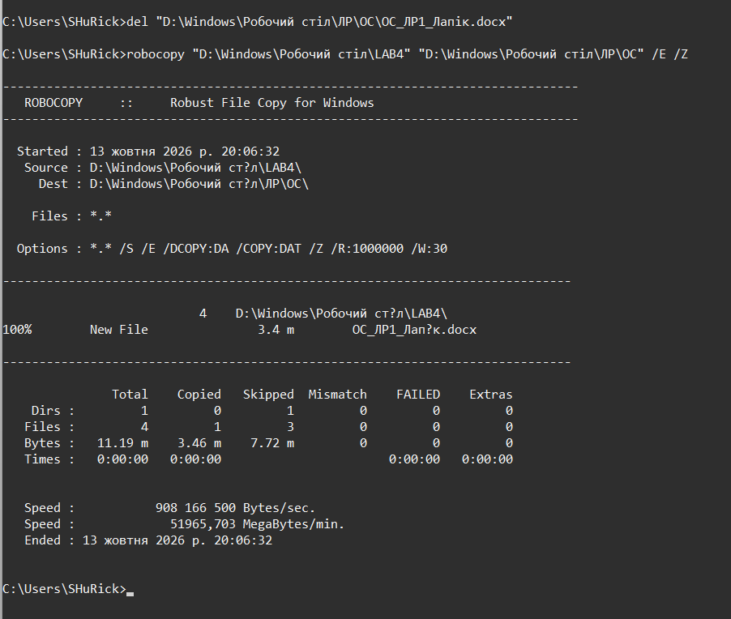
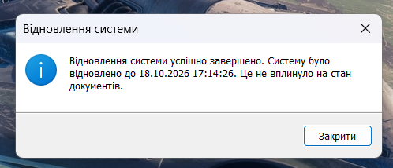
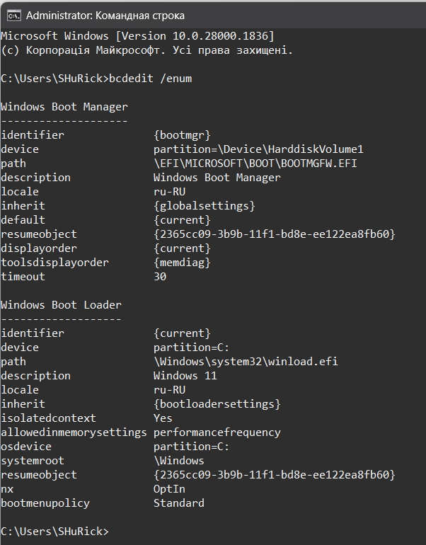
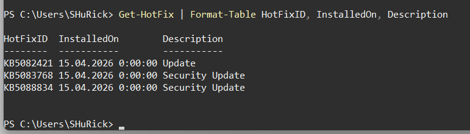

<!--
  Методи відновлення ОС
  Варіант 11: Програма не стартує після оновлення Windows — `/scan` — 1000 — Показати, як переглянути історію оновлень

  Тему, мету й обладнання писати не треба — конвеєр візьме їх із лабораторної.
  Знімки екрана кладіть у assets/, вихідний код — у src/.
  Контрольні питання — лише одного рівня, того, на який захищаєте роботу:
  заголовок «### Достатній рівень», далі «1 Текст питання?» і відповідь.
  Покрокова інструкція — reports/README.md
-->

## Хід роботи

1 Отримав в викладача номер мого індивідуального варіанту це варіант №11.

2 Зафіксував початковий стан системи: версію та збірку, час останнього завантаження, стан WinRE (reagentc /info), стан захисту системи. Зробив знімок екрана.

3 Створив точку відновлення з описом, що містить моє прізвище. Вивів перелік точок і зафіксував номер створеної.

Номер моєї створеної точки 2 ця точка містить моє прізвище Лапік.

4 Виконав перевірку сховища компонентів (DISM /ScanHealth) і цілісності системних файлів (sfc /scannow) у правильному порядку. Зберіг витяг із журналу CBS у файл на робочому столі.

5 Виконав перевірку файлової системи несистемного тому командою chkdsk з ключем свого варіанта. Пояснив у звіті, чому для системного тому перевірка відкладається.

Для системного тому перевірка відкладається через те, що диск C: є системним і на ньому працює поточний сеанс Windows, а виправлення помилок за допомогою ключа /f вимагає монопольного доступу. Через це з'являється пропозиція запланувати перевірку. Можна натиснути Y, і комп'ютер одразу перезапуститься, або вибрати N, щоб продовжити поточну роботу, а перевірка виконається під час наступного перезавантаження комп'ютера.

6 Отримав перелік критичних подій системного журналу за останній тиждень засобами PowerShell. Знайшов подію, зазначену у моєму варіанті, і пояснив її причину. Не всі події пишуться в журнал System: 1000, 1511, 1530 і 8194 шукають у журналі Application, 1116 — у журналі Microsoft-Windows-Windows Defender/Operational. Якщо такої події на вашій машині немає, пояснив, за яких обставин вона з’явилася б.

Я використав команду Get-WinEvent -FilterHashtable @{LogName='Application'; Id=1000; StartTime=(Get-Date).AddDays(-7)} -MaxEvents 5 | Select-Object TimeCreated, Id, ProviderName. Конструкцію StartTime=(Get-Date).AddDays(-7) я застосував для того, щоб обмежити пошук останнім тижнем; якщо її не вказати, система вивела б усі події з моменту встановлення ОС. У результаті з'явилося повідомлення, що за останній тиждень у системі не було зафіксовано аварійних завершень програм (тобто подій із кодом 1000) у журналі Application. Це свідчить про те, що операційна система працює стабільно і застосунки не падали.

7 Створив резервну копію навчального каталогу командою robocopy, видалив з оригіналу один файл і відновив його з копії. Зафіксував обидві дії.

8 Виконав сценарій відмови свого варіанта: змоделював проблему та відновив систему відповідним засобом. Обґрунтував вибір засобу за таблицею 1.

За моїм 11-м варіантом у мене був такий сценарій: програма не стартує після оновлення Windows. На мою думку, причина цього полягає в тому, що після встановлення оновлення операційної системи змінилися системні файли, ключі реєстру або драйвери, що спричинило конфлікт із програмним забезпеченням і призвело до збою в його запуску. Відповідно до таблиці 1 із теоретичного матеріалу, я подумав, що моїм симптомом буде: «Збої почалися після встановлення програми чи драйвера». Для вирішення цієї проблеми найкращим засобом є точка відновлення, після використання якої оновлюються реєстр, драйвери та системні файли. Спочатку я використав команду у PowerShell Get-ComputerRestorePoint | Format-Table SequenceNumber, Description, CreationTime, щоб дізнатися, під яким номером розташована моя остання створена точка відновлення. Після цього я використав команду Restore-Computer -RestorePoint 5, яка відновила систему за допомогою вибраної точки відновлення. Цей засіб є безпечним для користувацьких даних (таких як документи, зображення та особисті файли), але він змінює реєстр, драйвери та системні файли

9 Перевірив конфігурацію завантаження командою bcdedit /enum і пояснив призначення знайдених записів. Нічого не змінював.

Для перевірки конфігурації завантаження я виконав команду bcdedit /enum у командному рядку. У результаті виконання команди було виведено два основні блоки: перший це менеджер завантаження Windows (Windows Boot Manager) відповідає за ініціалізацію процесу завантаження на первинному етапі та керує параметрами відображення меню вибору ОС. Другий це завантажувач операційної системи (Windows Boot Loader): містить детальні інструкції для завантаження поточної операційної системи. Згідно з правилами безпеки лабораторної роботи, жодних змін у конфігурацію завантажувача я не вносив, оскільки випадкова помилка в записах BCD може призвести до повної втрати працездатності операційної системи.

10 Виконав додаткове завдання мого варіанта №11.

Для перевірки списку раніше встановлених оновлень ОС було використано команду Get-HotFix | Format-Table HotFixID, InstalledOn, Description. Команда вивела таблицю з ідентифікатороми оновлень та датами їх встановлення. Це дозволяє точно встановити після якого саме оновлення відбулися зміни в системі або виникли потенційні збої в роботі програм.

## Відповіді на контрольні питання

1 Після оновлення драйвера відеокарти система показує синій екран одразу після входу. Опишіть повний порядок відновлення із зазначенням засобу на кожному кроці й поясніть, чому саме в такій послідовності.

Після оновлення драйвера відеокарти система видає синій екран одразу при вході. Порядок відновлення: необхідно завантажитися у Безпечному режимі через середовище відновлення (WinRE), оскільки звичайний режим недоступний через збій. У безпечному режимі мінімальний набір драйверів дозволяє увійти в систему, після чого через Диспетчер пристроїв слід виконати відкат або видалення проблемного драйвера відеокарти. Така послідовність єдина правильна, адже вона ізолює систему від завантаження пошкодженого компонента та дає змогу керувати параметрами.

2 Користувач вимагає «щоб усе відновлювалося автоматично». Запропонуйте комбінацію засобів (точки відновлення, образ системи, файлові копії) і обґрунтуйте, від яких саме ризиків захищає кожен з них.

Для автоматизації захисту використовують комбінацію трьох засобів: точки відновлення (захищають від швидких збоїв реєстру та драйверів, повертаючи системні файли до стабільного стану), образ системи (захищає від повної відмови диска, зберігаючи копію всього тому разом із програмами) та файлові копії (Історія файлів або robocopy захищають найцінніше — користувацькі документи від випадкового видалення чи пошкодження носія). Разом вони перекривають ризики від дрібних програмних збоїв до катастрофічної втрати даних і апаратури.

3 Точка відновлення створена, але відкат не усуває проблему. Назвіть щонайменше три причини, чому так буває, і спосіб перевірити кожну.

Якщо точка відновлення не усуває проблему, це може статися з таких причин: перша — пошкоджена або застаріла саму точка відновлення (перевіряється командою Get-ComputerRestorePoint), і корінь проблеми ховається глибше або виник раніше за створення точки. Друга — проблема має апаратний характер (несправність оперативної пам'яті, перегрів чи збій диска), що перевіряється діагностичними утилітами (chkdsk або тестами пам'яті). Третя — пошкоджено саме сховище тіньових копій VSS, через що дані відновилися некоректно (перевіряється через vssadmin list shadowstorage).

4 Сформулюйте критерій, за яким адміністратор обирає між відновленням системи і переустановленням з нуля. Оцініть обидва варіанти за часом, ризиком і збереженням даних.

Головний критерій вибору між відновленням і переустановленням — баланс між часом на усунення несправності та ризиком втрати даних. За часом відновлення завжди швидше (займає хвилини), має мінімальний ризик втрати налаштувань і зберігає документи. Переустановлення «з нуля» триває довше (через потребу налаштовувати ПЗ заново), але повністю усуває будь-які накопичені системні похибки, хоча вимагає обов'язкової попередньої резервної копії даних, інакше вони будуть втрачені. Якщо пошкодження критичні і прості засоби не допомагають — обирають чисту установку.

## Висновок

На цій лабораторній роботі я опанував штатні засоби діагностики та відновлення Windows. Дізнався що лікувати систему можна засобами самої операційної системи — такими як перевірка цілісності системних файлів (sfc та DISM), точка відновлення (System Restore) або утиліти перевірки файлової системи та завантажувача (chkdsk, bcdedit) — успішно усуваються програмні збої, виклики яких полягають у пошкодженні реєстру, некоректному встановленні драйверів, програм чи оновлень, а також виникненні дрібних помилок у метаданих диска чи файлах Windows. Проте жоден із цих системних інструментів не здатен повернути втрачені, видалені або пошкоджені користувацькі документи, фотографії та особисті дані. Будь-які випадки втрати інформації внаслідок апаратного збою накопичувача, дій шкідливого програмного забезпечення чи випадкового видалення лікуються виключно за допомогою заздалегідь створеної резервної копії, оскільки системні засоби орієнтовані лише на реанімацію працездатності самої ОС, а не на збереження файлів користувача

