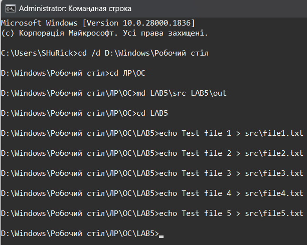
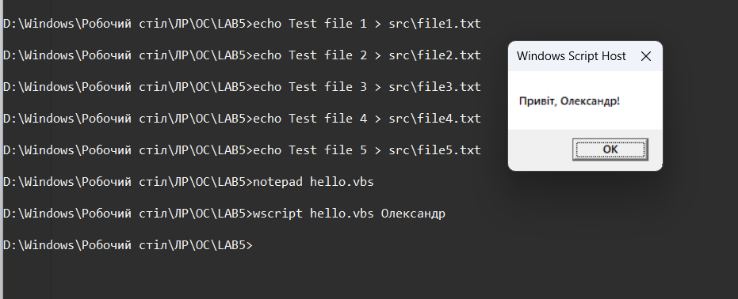
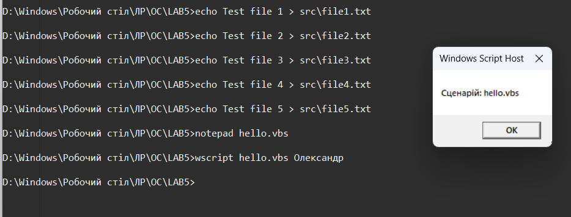
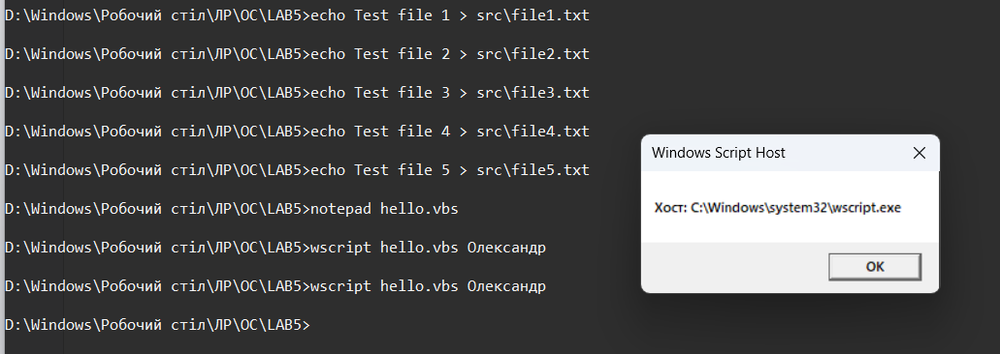
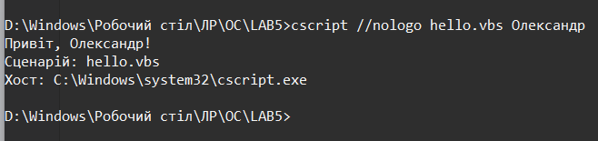
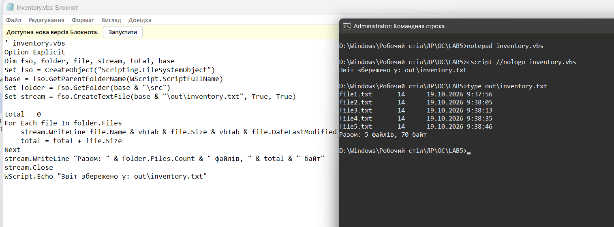
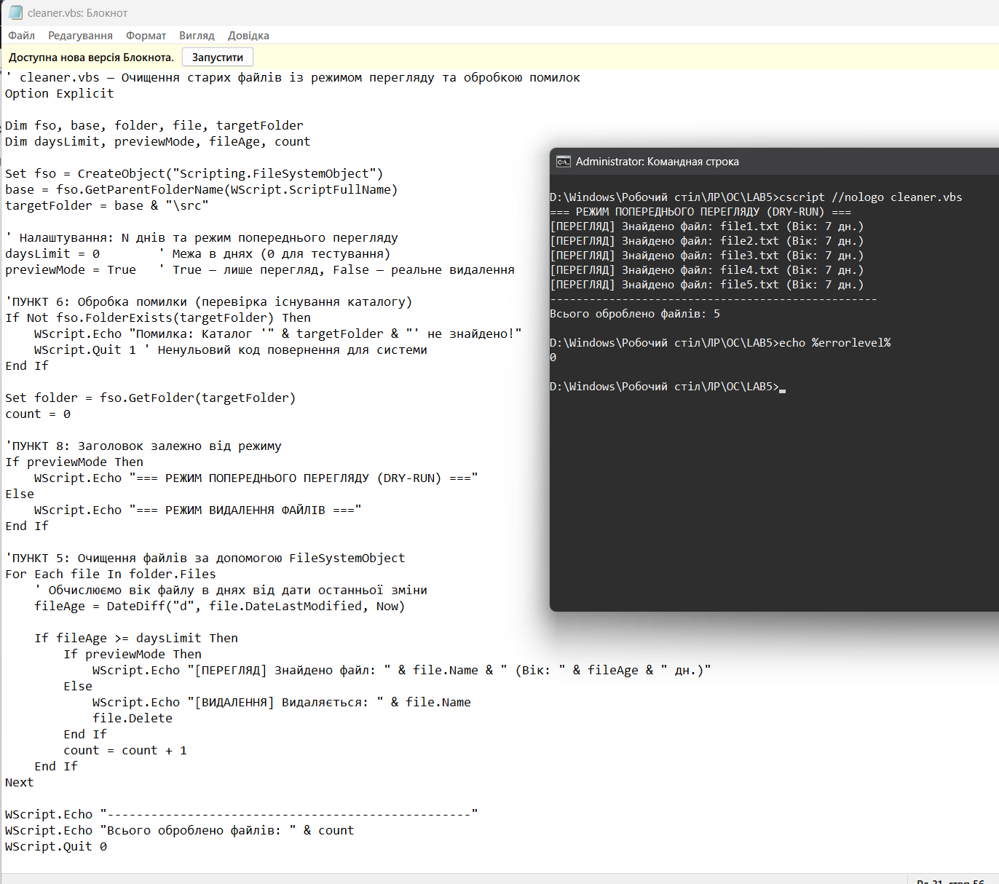
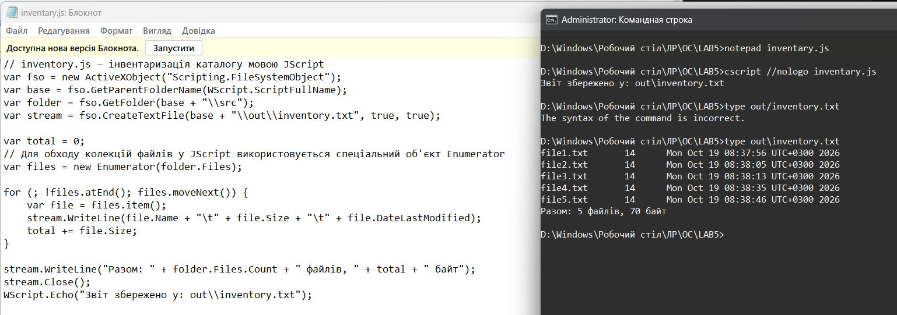

<!--
  Сценарії Windows Script Host
  Варіант 11: Очищення каталогу від файлів, старших за N днів — `FileSystemObject` — Реалізувати режим попереднього перегляду

  Тему, мету й обладнання писати не треба — конвеєр візьме їх із лабораторної.
  Знімки екрана кладіть у assets/, вихідний код — у src/.
  Контрольні питання — лише одного рівня, того, на який захищаєте роботу:
  заголовок «### Достатній рівень», далі «1 Текст питання?» і відповідь.
  Покрокова інструкція — reports/README.md
-->

## Хід роботи

1  Отримав в викладача номер індивідуального варіанта.

2 Створив на робочому столі каталог LAB5 з підкаталогами src і out, наповнив src щонайменше п’ятьма файлами.

3 Написав сценарій hello.vbs, який приймає аргумент, виводить привітання, ім’я сценарію та повне ім’я хоста. Запустив його двома способами — через wscript і через cscript — і пояснив різницю у виводі.

Код файлу hello.vbs:
Option Explicit
Dim name
If WScript.Arguments.Count > 0 Then
    name = WScript.Arguments(0)
Else
    name = "користувач"
End If
WScript.Echo "Привіт, " & name & "!"
WScript.Echo "Сценарій: " & WScript.ScriptName
WScript.Echo "Хост: " & WScript.FullName
WScript.Quit 0
Якщо порівнювати, то на скріншотах видно: при запуск через wscript результат виводиться у графічних модальних вікнах, і кожне вікно потрібно закривати окремо натисканням кнопки ОК. Натомість запуск через cscript виводить увесь текст безпосередньо в консоль рядок за рядком, що набагато зручніше для автоматизації.

4 Написав сценарій інвентаризації каталогу src: перелік файлів з розмірами й датами, підсумковий рядок, запис результату у файл out.txt в кодуванні Unicode.

Код файлу inventory.vbs:
' inventory.vbs
Option Explicit
Dim fso, folder, file, stream, total, base
Set fso = CreateObject("Scripting.FileSystemObject")
base = fso.GetParentFolderName(WScript.ScriptFullName)
Set folder = fso.GetFolder(base & "\src")
Set stream = fso.CreateTextFile(base & "\out\inventory.txt", True, True)

total = 0
For Each file In folder.Files
    stream.WriteLine file.Name & vbTab & file.Size & vbTab & file.DateLastModified
    total = total + file.Size
Next
stream.WriteLine "Разом: " & folder.Files.Count & " файлів, " & total & " байт"
stream.Close
WScript.Echo "Звіт збережено у: out\inventory.txt"
Сценарій інвентаризації використовує об’єкт Scripting.FileSystemObject для роботи з файловою системою. За допомогою GetParentFolderName і WScript.ScriptFullName визначається робочий каталог LAB5, а метод GetFolder дає доступ до папки src. Результати зберігаються у файл out\inventory.txt через метод CreateTextFile із параметром True для підтримки кодування Unicode. Сценарій циклом For Each обходить колекцію folder.Files, зчитуючи ім'я (Name), розмір (Size) та дату зміни (DateLastModified) кожного файлу. Дані форматуються через vbTab, обчислюється сумарний розмір, після чого підсумковий рядок записується у файл, а потік закривається методом Close. 

5 Реалізував основне завдання свого варіанта а саме створив сценарій очищення каталогів старших за N днів. Також додав до сценарію обробки помилок та реалізував режим попереднього перегляду.

Я вирішив поєднати 5, 6 та 8 завдання щоб було простіше переглядати звіт.
Код файлу cleaner.vbs:
' cleaner.vbs — Очищення старих файлів із режимом перегляду та обробкою помилок
Option Explicit

Dim fso, base, folder, file, targetFolder
Dim daysLimit, previewMode, fileAge, count

Set fso = CreateObject("Scripting.FileSystemObject")
base = fso.GetParentFolderName(WScript.ScriptFullName)
targetFolder = base & "\src"

' Налаштування: N днів та режим попереднього перегляду
daysLimit = 0        ' Межа в днях (0 для тестування)
previewMode = True   ' True — лише перегляд, False — реальне видалення

'ПУНКТ 6: Обробка помилки (перевірка існування каталогу)
If Not fso.FolderExists(targetFolder) Then
    WScript.Echo "Помилка: Каталог '" & targetFolder & "' не знайдено!"
    WScript.Quit 1 ' Ненульовий код повернення для системи
End If

Set folder = fso.GetFolder(targetFolder)
count = 0

'ПУНКТ 8: Заголовок залежно від режиму
If previewMode Then
    WScript.Echo "=== РЕЖИМ ПОПЕРЕДНЬОГО ПЕРЕГЛЯДУ (DRY-RUN) ==="
Else
    WScript.Echo "=== РЕЖИМ ВИДАЛЕННЯ ФАЙЛІВ ==="
End If

'ПУНКТ 5: Очищення файлів за допомогою FileSystemObject
For Each file In folder.Files
    ' Обчислюємо вік файлу в днях від дати останньої зміни
    fileAge = DateDiff("d", file.DateLastModified, Now)
    If fileAge >= daysLimit Then
        If previewMode Then
            WScript.Echo "[ПЕРЕГЛЯД] Знайдено файл: " & file.Name & " (Вік: " & fileAge & " дн.)"
        Else
            WScript.Echo "[ВИДАЛЕННЯ] Видаляється: " & file.Name
            file.Delete
        End If
        count = count + 1
    End If
Next

WScript.Echo "--------------------------------------------------"
WScript.Echo "Всього оброблено файлів: " & count
WScript.Quit 0
Для роботи сценарію очищення каталогу задіюється COM-об'єкт Scripting.FileSystemObject та методи визначення й перевірки шляхів, а обробка помилок реалізована через перевірку існування папки з виходом із ненульовим кодом. Логіка додаткового завдання використовує прапорець previewMode для перемикання між переглядом і видаленням, обходячи файли через колекцію folder.Files та властивість DateLastModified. Щодо елементів які я знайшов в інтернеті, яких не було в теорії, : вбудована функція DateDiff порівнює дату файлу з поточним часом для обчислення віку в днях, а метод file.Delete виконує фізичне видалення файлу, коли вимкнено режим попереднього перегляду. На завершення виводиться загальна кількість файлів через WScript.Echo і сценарій закривається кодом WScript.Quit 0. Цей сценарій використовує тестові дані тому прапорець previewMode завжди True у режимі перегляду тому файли лише виводять та переглядають а не видаляють. Цей сценарій використовує тестові дані, тому прапорець previewMode встановлено у значення True. У цьому режимі файли лише виводяться для перегляду, а не видаляються.

6 Переписав один із написаних сценаріїв мовою JScript і порівняв обидві реалізації за обсягом та читабельністю.

Код файлу inventory.js:
// inventory.js — інвентаризація каталогу мовою JScript
var fso = new ActiveXObject("Scripting.FileSystemObject");
var base = fso.GetParentFolderName(WScript.ScriptFullName);
var folder = fso.GetFolder(base + "\\src");
var stream = fso.CreateTextFile(base + "\\out\\inventory.txt", true, true);

var total = 0;
// Для обходу колекцій файлів у JScript використовується спеціальний об'єкт Enumerator
var files = new Enumerator(folder.Files);

for (; !files.atEnd(); files.moveNext()) {
    var file = files.item();
    stream.WriteLine(file.Name + "\t" + file.Size + "\t" + file.DateLastModified);
    total += file.Size;
}

stream.WriteLine("Разом: " + folder.Files.Count + " файлів, " + total + " байт");
stream.Close();
WScript.Echo("Звіт збережено у: out\\inventory.txt");
Порівнюючи реалізації сценарію інвентаризації мовами VBScript та JScript, слід зазначити, що їхня об'єктна модель є однаковою, проте вони суттєво відрізняються за синтаксисом, обсягом та читабельністю. VBScript є більш лаконічним і простим для сприйняття завдяки використанню природних конструкцій на кшталт For Each ... In ..., які дозволяють напряму перебирати колекції файлів. Водночас JScript вимагає дещо більшого обсягу коду, використання C-подібного синтаксису (крапок з комою, фігурних дужок) та обов'язкового застосування спеціального об'єкта Enumerator для обходу колекцій, оскільки для цього в JScript потрібен саме такий додатковий механізм. Щодо інших завдань, мовою JScript (JavaScript) значно зручніше виконувати сценарії, які потребують складного текстового аналізу, обробки великих масивів рядкових даних, використання регулярних виразів або роботи з веб-ресурсами й мережевими протоколами. Наприклад, якщо б у рамках лабораторної роботи чи реальних системних завдань потрібно було автоматично парсити вміст складних конфігураційних файлів, шукати певні шаблони в логах за допомогою регулярних виразів чи обробляти дані у форматах XML/JSON, синтаксис JScript надав би набагато потужніші вбудовані інструменти та більш звичну структуру коду порівняно зі застарілим синтаксисом VBScript.

## Відповіді на контрольні питання

1 Організація має сотню робочих станцій і потребує щотижневого звіту про вільне місце на дисках. Опишіть, як розв’язати задачу засобами WSH: які об’єкти, як зібрати результати, які обмеження виникнуть.

Для розв’язання цієї задачі засобами WSH найефективніше використовувати службу WMI (winmgmts) через запит до класу Win32_LogicalDisk або об'єкт Scripting.FileSystemObject для опитування логічних дисків. Збір результатів можна організувати шляхом розгортання сценарію на кожній робочій станції через планувальник завдань із подальшим збереженням звітів у спільну мережеву папку або централізованим запуском зі скрипта-менеджера, який по черзі опитує комп'ютери за їхніми мережевими іменами. Основними обмеженнями при цьому стануть мережеві обмеження та брандмауери, які часто блокують віддалений доступ до WMI, необхідність наявності адміністративних прав на кожній станції для читання даних, а також низька швидкість послідовного опитування сотні машин, оскільки WSH не має зручних вбудованих механізмів багатопоточності.

2 Сценарій .vbs — класичний носій шкідливого коду. Поясніть, які саме можливості WSH роблять його небезпечним і якими засобами системи цей ризик обмежують.

Небезпека сценаріїв WSH зумовлена тим, що вони мають прямий і повноцінний доступ до об’єктної моделі системи через технологію COM, що дозволяє безперешкодно запускати довільні програми, маніпулювати файловою системою, змінювати системний реєстр та взаємодіяти з мережею без виведення попереджень користувачу. Для обмеження цих ризиків сучасна операційна система використовує комплекс захисних механізмів, таких як антивірусне програмне забезпечення та вбудований Захисник Windows, який аналізує поведінку скриптів, контроль облікових записів користувачів (UAC), а також поетапне обмеження й вимкнення підсистеми VBScript у новітніх версіях Windows 11 на кшталт 24H2, де вона переведена в статус додаткового компонента на вимогу з подальшим повним видаленням із системи.

3 Порівняйте WSH і PowerShell за трьома критеріями: доступ до системи, читабельність коду, наявність у сучасних версіях Windows. У яких випадках вибір WSH сьогодні виправданий?

Порівнюючи WSH та PowerShell за критерієм доступу до системи, слід зазначити, що WSH спирається на застарілу технологію COM та WMI, тоді як PowerShell використовує потужну платформу .NET, що забезпечує набагато глибший, швидший та універсальніший контроль над усіма компонентами операційної системи. За критерієм читабельності коду PowerShell пропонує зручні конвеєри та короткі командлети, роблячи код компактним і зрозумілим, тоді як WSH вимагає громіздких конструкцій (особливо в JScript або під час побудови складних WMI-запитів). Що стосується наявності в сучасних версіях Windows, то PowerShell є стандартом і вбудований за замовчуванням у всі актуальні системи, тоді як застарілий WSH та особливо VBScript поетапно виводяться з експлуатації та видаляються з Windows 11. Вибір WSH сьогодні виправданий виключно в рамках підтримки спадкових інфраструктур і застарілого програмного забезпечення на підприємствах, де тисячі старих сценаріїв працюють роками і їхнє термінове масове переписування на PowerShell є економічно недоцільним.

4 Той самий алгоритм реалізовано пакетним файлом і сценарієм WSH. Сформулюйте критерії, за якими ви оберете один із варіантів, і проілюструйте кожен критерій прикладом із цієї роботи.

Вибір між пакетним файлом та сценарієм WSH зазвичай базується на критеріях складності логіки обробки даних та потреби в глибокому доступі до об'єктної моделі системи. Якщо алгоритм вимагає роботи зі складною логікою, типами даних, функціями чи обробкою помилок, перевагу віддають WSH, тоді як для простих послідовних викликів утиліт краще підходить пакетний файл. Проілюструвати це можна на прикладі завдання інвентаризації каталогу з цієї лабораторної роботи, де сценарій інвентаризації за допомогою об'єкта FileSystemObject перебирає файли, зчитує їхні точні дати й розміри та формує структурований звіт у кодуванні Unicode, що було б надзвичайно громіздко й обмежено для реалізації звичайним пакетним файлом. Іншим критерієм є необхідність доступу до системної інформації та COM-об'єктів, що чудово демонструє сценарій збору паспорта системи через WMI-запити, чого пакетні файли взагалі не здатні виконати самостійно без залучення сторонніх командних утиліт.

## Висновок

на цій лабораторній роботі я ознайомився з підсистемою Windows Script Host, навчився писати сценарії мовами VBScript і JScript, працював з файловою системою через об’єктну модель FileSystemObject, керував оточенням і ярликами через WScript.Shell та отримував відомості про систему через WMI. Підсумовуючи можливості різних інструментів автоматизації, можна дійти висновку, що вибір конкретного засобу залежить від складності завдання. Звичайні пакетні файли є найефективнішими для найпростіших лінійних послідовностей команд і пакетного запуску утиліт. Засоби WSH, що спираються на технологію COM та WMI, сьогодні виправдані переважно для підтримки тисяч спадкових сценаріїв на підприємствах, проте через застарілість і поетапне видалення з новітніх версій Windows вони поступаються місцем новішим інструментам. Водночас PowerShell є сучасним і потужним стандартом адміністрування на базі платформи .NET, який забезпечує набагато глибший, швидший та безпечніший контроль над усіма компонентами операційної системи, тому саме він є найкращим вибором для будь-яких нових завдань автоматизації
